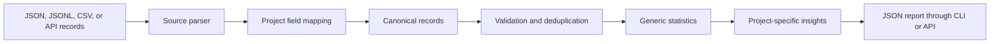

# Reusable Data Analysis Pipeline

**Status:** Implemented
**Backend:** TypeScript / Node.js
**Purpose:** Analyze Sentinel events now and reuse the same engine for future
projects through declarative field mappings.

## What the pipeline does



The reusable core handles:

- JSON, JSONL/NDJSON, and RFC 4180-style CSV input;
- common JSON envelopes named `records`, `events`, `data`, or `items`;
- nested field selection through dot-separated paths;
- Unix-second, Unix-millisecond, and ISO timestamp normalization;
- required-field, timestamp, number, and allowed-outcome validation;
- duplicate detection by record ID;
- data coverage rates for every mapped field;
- counts by category and outcome;
- numeric count, minimum, maximum, sum, mean, median, and p95;
- daily trends, entity summaries, and unique actor counts;
- parse-error reporting with source and row locations.

It does not pretend that every project's meaning is identical. A new project
reuses the parser, validator, and statistics engine, then supplies a mapping
definition and optional domain-specific insight function.

Generic metric summaries describe record-level observations. If the same
business value appears in several lifecycle events, its generic sum will also
appear several times. Domain layers must select the authoritative event type;
Sentinel therefore calculates USDC volume and gas from successful swap events
only.

## Sentinel evidence captured

New events preserve the original frontend-compatible fields and add structured
context:

```text
correlationId, account, tokenIn, tokenOut, amountIn,
quotedOut, actualOut, amountOutMin, slippageBps,
expectedOut, quoteDeviation, historicalFailureRate,
poolRiskScore, priceImpactBps,
gasUsed, blockNumber, executionMode, safetyMode,
requestedRouteId, executedRouteId, pairAddress,
poolLabel, configProfile, flags, errorCode,
failureStage, prevented, chainMode, source, schemaVersion,
transaction hash, raw token amounts, batch counts
```

The correlation ID joins evaluation, decision, fallback, and execution events
belonging to one operation. Existing legacy events remain readable, but their
new-field coverage will correctly be reported as zero or incomplete.

Sentinel's domain layer calculates:

- operational ALLOW, REJECT, and FALLBACK decision counts, separate from
  preview-only evaluations;
- intervention rate;
- observed fallback events and completed fallback swaps;
- swap attempts, successes, and true execution-failure rate;
- separate Agent-prevented, precondition, configuration, and unclassified
  failure counts;
- force/bypass event count;
- realized slippage from paired quote and actual output;
- rich-evidence coverage and unique account count;
- an evidence-readiness assessment.

The assessment remains `prototype-evidence-only` until all of these criteria
are met:

- at least 30 successful safe-mode swaps in RPC mode;
- quote and actual output on at least 80% of those swaps;
- at least 30 safe-mode decisions in RPC mode;
- complete quote-deviation, configured-failure-rate, and pool-risk evidence on
  at least 80% of those decisions;
- at least three distinct accounts; and
- evidence spanning at least seven UTC dates.

Demo and forced swaps never satisfy this gate. The report returns every
criterion with its actual value, required value, and pass/fail result.

## Analyze Sentinel events

From `backend/`:

```bash
npm run analyze -- --input data/events.jsonl
```

Write a full report:

```bash
npm run analyze -- \
  --input data/events.jsonl \
  --output ../tmp/sentinel-analysis.json
```

Include normalized records:

```bash
npm run analyze -- \
  --input data/events.jsonl \
  --include-records
```

Make data-quality failures return a nonzero process status:

```bash
npm run analyze -- \
  --input data/events.jsonl \
  --fail-on-invalid
```

Use `npm run analyze -- --help` for all CLI options.

## Analyze another project

Create a JSON definition:

```json
{
  "name": "orders",
  "version": "1.0.0",
  "fields": {
    "id": "order_id",
    "timestamp": "created_at",
    "category": "kind",
    "outcome": "status",
    "score": "risk_score",
    "entityId": "customer.id",
    "actorId": "created_by"
  },
  "dimensions": {
    "region": "customer.region",
    "channel": ["sales_channel", "channel"]
  },
  "metrics": {
    "amount": "total",
    "latencyMs": "processing.latency_ms"
  },
  "required": ["id", "timestamp", "category"],
  "allowedOutcomes": ["completed", "failed", "cancelled"]
}
```

Then run:

```bash
npm run analyze -- \
  --input orders.csv \
  --config orders-analysis.json
```

A selector can be a single path or an ordered list of fallback paths. The
definition is data only; it cannot execute code. `id`, `timestamp`, and
`category` are always required canonical fields. A `required` array may add
other canonical fields, but it must retain those three.

## API

### Analyze the persisted Sentinel log

```http
GET /api/analysis
```

Returns the analysis report. Corrupt JSONL lines are included in data-quality
counts instead of being silently ignored.

The same live report is rendered in the frontend at `/analysis`, including
decision bars, daily activity, data quality, risk summaries, field coverage,
execution outcomes, readiness criteria, and route activity.

### Inspect the Sentinel mapping

```http
GET /api/analysis/definition
```

### Analyze supplied records

```http
POST /api/analysis/run
Content-Type: application/json

{
  "records": [],
  "definition": {},
  "includeRecords": false
}
```

`definition` is optional and defaults to Sentinel. The endpoint accepts at
most 10,000 records and does not persist submitted records.

## Data handling

- Local runtime events remain in `backend/data/events.jsonl`, which is ignored
  by Git.
- The generic `/analysis/run` endpoint analyzes request data in memory only.
- Event context stores analysis evidence but not private keys, signatures,
  environment variables, or complete wallet balance snapshots.
- Ethereum account addresses and transaction hashes are public identifiers but
  should still be treated as linkable user data when reports are shared.
- Dashboard safe volume now sums captured USDC inputs. Non-USDC assets are not
  assigned an invented USD price.
- Raw Vault amounts are retained for coverage and audit, but are not combined
  into cross-token volume without token identity, decimals, and price context.
- Invalid rows are reported; the original input is not rewritten or deleted.
- Clearing or retention remains an explicit operator action. Analysis never
  deletes source data.

## Main implementation files

| File | Responsibility |
|---|---|
| `backend/src/analysis/sourceParsers.ts` | JSON, JSONL, and CSV ingestion |
| `backend/src/analysis/definition.ts` | Safe definition validation |
| `backend/src/analysis/engine.ts` | Normalization, quality checks, aggregation |
| `backend/src/analysis/sentinel.ts` | Sentinel-specific evidence metrics |
| `backend/src/config/sentinel-analysis.json` | Sentinel field mapping |
| `backend/src/services/analysisService.ts` | Backend integration |
| `backend/src/routes/analysis.ts` | Analysis HTTP API |
| `backend/src/cli/analyze.ts` | Reusable command-line runner |
| `backend/test/analysis-engine.test.ts` | Parser and engine regression tests |
| `backend/test/analysis-api.test.ts` | Analysis API integration tests |
| `frontend/src/components/AnalysisPage.tsx` | Live evidence visualization |
