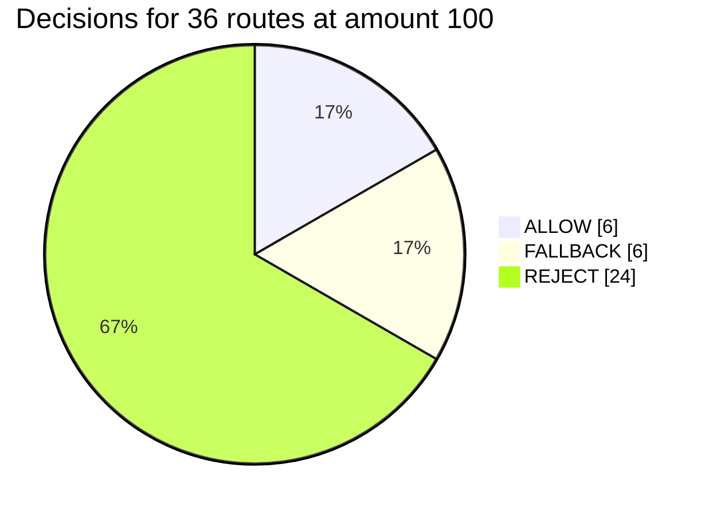

# Sentinel Data Analysis

**Analysis date:** 2026-07-29 (baseline); **scenario update:** 2026-07-31  
**Repository commit:** `831c806` (baseline body); current demo = **48 routes**  
**Scope:** Synthetic demo scenario, deterministic risk rules, contract tests, and reporting data.

> **2026-07-31 update:** Demo expanded from 36 to **48 routes** by adding an **SDA** pool per directed pair (12 × 4). SDA pools use SAFE-depth liquidity but Agent **REJECT**s in Safe mode (execution-window risk). Force-mode verify-all now expects **36 pass + 12 TOXIC slippage failures** at default 1% band. Safe vs force slippage split is documented in [`architecture.md`](architecture.md) and [`route-scenarios.md`](route-scenarios.md). Counts and charts below describe the original **36-route (SAFE/SHALLOW/TOXIC only)** baseline unless noted.

**Companion workbook:** [`sentinel-data-analysis.xlsx`](sentinel-data-analysis.xlsx) contains formula-driven route observations for the baseline matrix.

> This document is the baseline analysis of commit `831c806`. The subsequent
> reusable implementation is documented in
> [`analysis-pipeline.md`](analysis-pipeline.md): it adds structured event
> evidence, validation, coverage reporting, generic JSON/JSONL/CSV ingestion,
> CLI execution, and analysis APIs. Historical conclusions still require newly
> collected runtime data.

## Executive summary

Sentinel demonstrates the intended safe-execution behavior inside its controlled demo:

- destinations tagged `BAD` or `BAIT` are always rejected;
- SAFE pools are allowed when the destination token is not tagged risky;
- SHALLOW pools can trigger fallback when the trade is large enough;
- TOXIC pools are rejected by the current scoring formula;
- all 36 raw pool routes can execute when safety checks are deliberately bypassed.

For a 100-token input under the normal risk profile, the 36-route matrix produces:

| Decision | Routes | Share |
|---|---:|---:|
| ALLOW | 6 | 16.7% |
| FALLBACK | 6 | 16.7% |
| REJECT | 24 | 66.7% |
| **Total** | **36** | **100%** |



This supports a prototype-level conclusion: Sentinel classifies and controls synthetic risks deterministically. It does not yet prove real-world attack detection, financial-loss prevention, or production performance.

## Data sources

| Source | Data used | Classification |
|---|---|---|
| `DemoScenarioDeployer.sol` | Tokens, price ratios, reserves, 36-route matrix | Scenario-defined |
| `DemoPoolRegistry.sol` | Pool labels and token risk tags | Scenario-defined on-chain |
| `UniswapV2Quote.sol` | Quotes and price impact | Derived from on-chain reserves |
| `chainQuoteService.ts` | Failure rates and pool risk scores | Synthetic/derived |
| `agentService.ts` | Risk scores and decisions | Deterministic derived data |
| Foundry tests | Swap and contract validation outcomes | Measured test evidence |
| `events.jsonl` | Runtime events | No collected dataset present in the repository |

The analysis deliberately excludes the dashboard's estimated volume, security score, gas-saving estimate, and placeholder statuses because they are not direct experimental measurements.

## Scenario structure

The demo contains:

- 4 tokens: `USDC`, `GOOD`, `BAD`, and `BAIT`;
- 12 directed token pairs;
- 3 pools per directed pair: `SAFE`, `SHALLOW`, and `TOXIC`;
- 36 total routes.

The configured price ratio is:

```text
USDC : GOOD : BAD : BAIT = 1 : 20 : 100 : 1
```

Pool characteristics are fixed by the scenario:

| Pool | Failure rate | Base pool risk | Fallback supported | Main behavior |
|---|---:|---:|---|---|
| SAFE | 2% | 12 | No | Deep reference liquidity |
| SHALLOW | 25% | 55 | Yes | Trade-size-sensitive price impact |
| TOXIC | 35% | 88 | Yes | Quote approximately 25% above the SAFE reference |

These failure rates are configuration values, not observations from historical transactions.

## Decision methodology

The normal profile uses these thresholds:

| Input | Threshold |
|---|---:|
| Quote deviation | Greater than 0.8% |
| Historical failure rate | Greater than 20% |
| Pool risk | Greater than 70 |
| High price-impact warning | Greater than 500 bps (5%) |
| Maximum execution slippage | 100 bps (1%) |
| Fallback decision | Score 40–69 with fallback support |
| Reject decision | Score 70 or greater |

There is also a hard token rule:

```text
tokenOut = BAD or BAIT → REJECT, riskScore = 100
```

Because 9 routes end in BAD and 9 end in BAIT, 18 of the 36 routes are rejected before ordinary pool scoring determines the result.

## Results

### Result by trade size

| Input amount | ALLOW | FALLBACK | REJECT |
|---:|---:|---:|---:|
| 1 | 12 | 0 | 24 |
| 10 | 12 | 0 | 24 |
| 100 | 6 | 6 | 24 |

```mermaid
xychart-beta
    title "Decision sensitivity to input amount"
    x-axis ["1", "10", "100"]
    y-axis "Routes" 0 --> 36
    bar [12, 12, 6]
    bar [0, 0, 6]
    bar [24, 24, 24]
```



Chart series, in order: ALLOW, FALLBACK, REJECT.

The fallback mechanism is amount-sensitive. At amounts 1 and 10, the SHALLOW routes do not accumulate enough score to reach the fallback threshold. At amount 100, their price impact and quote deviation raise the score into the fallback range.

### Result by pool at amount 100

| Pool | ALLOW | FALLBACK | REJECT | Explanation |
|---|---:|---:|---:|---|
| SAFE | 6 | 0 | 6 | BAD/BAIT destinations account for the six rejects |
| SHALLOW | 0 | 6 | 6 | Six ordinary destinations fallback; BAD/BAIT destinations reject |
| TOXIC | 0 | 0 | 12 | Ordinary routes score about 94; BAD/BAIT routes hard-reject |

### Representative USDC → GOOD routes at amount 100

| Route | Quoted output | Price impact | Pool risk | Final score | Decision |
|---|---:|---:|---:|---:|---|
| `route-usdc-good-safe` | 4.9845 GOOD | 30 bps | 15 | 0 | ALLOW |
| `route-usdc-good-shallow` | 4.1562 GOOD | 1,687 bps | 72 | 69 | FALLBACK |
| `route-usdc-good-toxic` | 6.2157 GOOD | 54 bps | 88 | 94 | REJECT |

The TOXIC quote looks better than the SAFE quote, but this is intentional scenario construction. Its rejection is driven by deviation from the SAFE reference, configured failure rate, and pool risk—not by observed malicious transactions.

## Validation evidence

Fresh validation produced:

| Check | Result |
|---|---|
| Backend TypeScript build | Passed |
| Frontend TypeScript/Vite build | Passed |
| Foundry suites | 11 passed |
| Foundry tests | 50 passed, 0 failed (incl. 48/48 direct pool swaps) |
| Direct swaps across demo pools | 48/48 passed (forge); force verify-all: 36/36+12 expected fail |
| Router + Vault integration coverage | 1 SAFE route tested |

The forge **48/48** result validates direct pool mechanics (including SDA pools). Force verify-all at default slippage: **36 pass + 12 TOXIC slippage blocks**. Those tests bypass the Agent and Vault for raw execution, so they must not be presented as fully protected swaps. The Router + Vault integration test covers only `route-usdc-good-safe`.

## Data-quality findings

### 1. Baseline runtime event data was incomplete

The persisted event schema contains:

```text
id, timestamp, eventType, routeId, decision,
riskScore, fallbackRouteId, message, txHash
```

At baseline it did not preserve wallet address, token pair, amount, quote,
actual output, pool, gas, block number, execution mode, or balance changes.
The new structured context captures the analyzable evidence and reports
coverage gaps for legacy rows. No `events.jsonl` dataset is committed, so this
document's conclusions still come from scenario and test data rather than
historical usage.

### 2. Dashboard metrics are not experimental results

- At baseline, safe volume was calculated as successful event count multiplied
  by `$100`. New structured events now sum observed USDC input amounts; legacy
  events contribute zero rather than an invented amount.
- The security score starts at `85` and applies fixed event penalties.
- Missing or zero pool scores can be replaced by hard-coded values.
- Direct-mode gas is estimated as Router gas multiplied by `2.8`.
- Badge progress depends on estimated safe volume.

These values should be described as UI demonstrations, not measured findings.

### 3. Pool health mixes classification with availability

Every non-SAFE pool is marked `degraded` even if it has liquidity and can swap successfully. The initial dashboard will therefore report approximately:

| Status | Pools |
|---|---:|
| Healthy | 12 |
| Degraded | 24 |
| Empty | 0 |

This means `degraded` primarily reflects scenario label, not a failed or unavailable pool.

### 4. Fallback evidence required preservation

The baseline implementation replaced the original fallback decision with the
SAFE route's follow-up evaluation. The current implementation preserves the
original Agent decision in the result and records both requested and executed
route IDs, so completed fallbacks remain measurable.

### 5. Vault loss is not economically comparable

`VaultExecution.computeLossBps` compares raw `amountIn` and raw `amountOutQuoted`. These values can represent different tokens with different prices and decimal precision. The result is therefore not a valid cross-token loss percentage.

### 6. The baseline fallback example was inconsistent

The old demo script described `route-usdc-good-toxic` with amount 1 as a
fallback, although current rules reject that route. The demo and API
documentation now use this reproducible example:

```text
route-usdc-good-shallow, amountIn = 100
```

## Goal assessment

| Project goal | Evidence | Assessment |
|---|---|---|
| Block configured risky destination tokens | 18 BAD/BAIT routes hard-reject | Achieved in the synthetic scenario |
| Distinguish pool execution risk | SAFE, SHALLOW, and TOXIC produce different outcomes | Achieved in the synthetic scenario |
| Redirect moderate risk to a safe route | Six SHALLOW routes fallback at amount 100 | Achieved, but amount-sensitive |
| Enforce signed execution constraints | Vault signature, deadline, nonce, pause tests pass | Functionally demonstrated |
| Validate all demo swap paths | 48/48 direct swaps pass (forge) | Achieved for raw pool execution |
| Provide auditable analytics | Minimal JSONL events; no historical dataset | Partially achieved |
| Demonstrate real-world safety improvement | No real-world or historical data | Not established |

## Conclusion

The available evidence supports Sentinel as a functioning synthetic proof of concept. Its strongest result is deterministic separation of configured safe, moderate-risk, and blocked routes, combined with working pool execution and tested Vault controls.

The analysis should not claim that Sentinel has measured real-world attack detection accuracy, prevented actual financial losses, or validated 36 fully protected Agent-and-Vault swaps. Those claims require richer persisted transaction data and experiments against independent or real-world observations.
